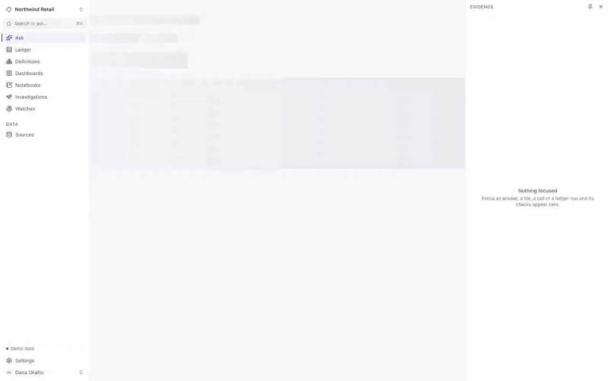
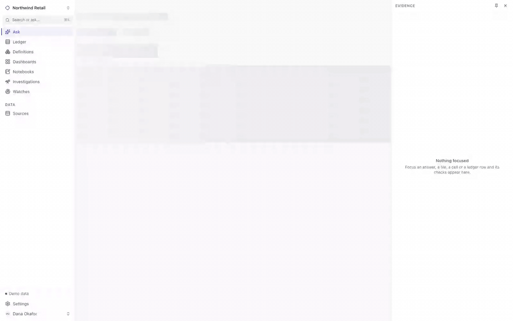
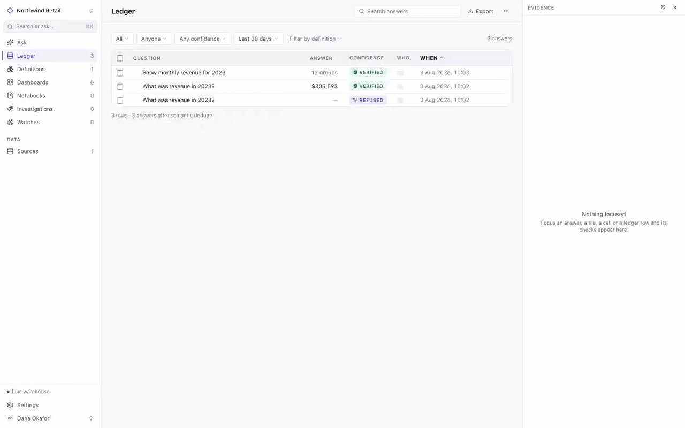
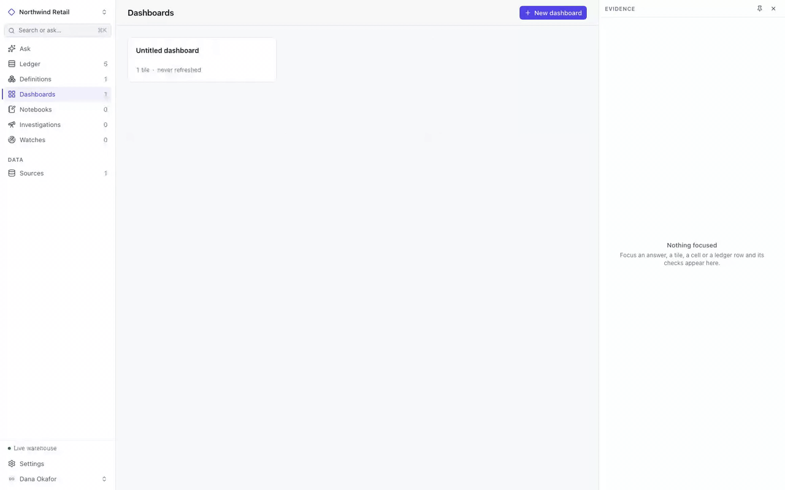

<div align="center">

# Analyst

### Ask a question in plain English. Get a number that shows its work.

An open-source, self-hosted AI data analyst — the kind of tool Wisdom AI and
ThoughtSpot Sage sell as a service, and Hex sells as part of a notebook
platform — with one difference that runs through everything:
**it tries to prove itself wrong before it answers you.**

[](https://github.com/anshal21/open-wisdom/actions/workflows/ci.yml)
[](LICENSE)
[](backend/)
[](frontend/)
[](#security-posture)

[Quickstart](#quickstart) ·
[The seal](#the-seal) ·
[Measured accuracy](#how-well-does-it-actually-work) ·
[How it compares](#how-it-compares) ·
[Contributing](CONTRIBUTING.md) ·
[Discussions](https://github.com/anshal21/open-wisdom/discussions)

</div>



<sub>Real recording, real data, real model ([crisp mp4](docs/assets/ask-refuse-verify.mp4)).
"Revenue" has two defensible readings in this warehouse — $305,593 net or
$359,761 gross — so instead of guessing, Analyst shows both figures and asks.
Your choice becomes a ratified definition, and only then does the answer earn
its **VERIFIED** seal: independently re-derived by a different query route,
eight structural checks passed. The model-thinking pauses are sped up 8×;
nothing else is edited.</sub>

---

## What you get

- **Answers that carry proof, not vibes** — every figure is re-derived by a
  second, independent query and run through a [deterministic check
  suite](#the-seal) before it earns a seal.
- **Refusal over guessing** — a question with two defensible readings shows
  you both figures and asks. Your choice becomes a [ratified
  definition](#the-seal) the whole workspace reuses.
- **A ledger, not a chat log** — every answer is a durable record with a
  permalink, both SQL derivations, the checks that ran, and what the run cost.
- **Dashboards and notebooks with the same standards** — a verified answer
  becomes a tile that keeps its seal; notebook cells run the [full
  pipeline](#how-it-works).
- **A measured accuracy number you can reproduce** — the model conformance
  suite [publishes its score](#how-well-does-it-actually-work), and you can
  run it against your own provider.
- **Extension seams, not forks** — model providers, data connectors and chart
  forms are [one-file plugins](#extending-it) behind conformance suites.
- **Your data stays yours** — self-hosted, warehouse mounted read-only,
  loopback by default, [zero telemetry](#security-posture). The default
  provider is an offline mock: first run costs nothing and sends nothing.

---

## Quickstart

Point it at a DuckDB file you already have:

```bash
git clone https://github.com/anshal21/open-wisdom.git && cd open-wisdom
ANALYST_DATA_DIR=~/warehouses ANALYST_WAREHOUSE_FILE=sales.duckdb docker compose up
```

Open <http://localhost:3000>. Your warehouse is mounted read-only; nothing is
written to it.

Nothing to point it at yet? Generate a sample warehouse first — optional, and
built on your machine from a seeded generator in this repository, so nothing is
downloaded:

```bash
./scripts/setup-sample-data.sh   # ~2 MB, a fictional clothing retailer
docker compose up
```

Or run `docker compose up` with neither. It starts, and asks you to add a
source.

Either way the first run needs **no API key, makes no network calls, and costs
nothing**: the default model provider is a deterministic `mock`. You get real
charts, real checks and real seals over real data — the model's answers are
canned, but everything around them is the actual product.

To get genuine answers, point it at a model:

```bash
# Anthropic API
ANALYST_LLM=anthropic ANTHROPIC_API_KEY=sk-... docker compose up

# or reuse an existing Claude Code login, no API key needed
ANALYST_LLM=claude-cli docker compose up
```

### Running without Docker

<details>
<summary>Prerequisites and local setup</summary>

| Requirement | Version | Why |
|---|---|---|
| Go | ≥ 1.25 | backend |
| `CGO_ENABLED=1` | — | DuckDB is a cgo binding with vendored native libraries; it cannot be built with cgo disabled |
| Node.js | ≥ 22 | frontend |
| Python | ≥ 3.11 | *optional* — only to execute notebook Python cells, which are disabled by default |
| A model provider | — | *optional* — `mock` is the default and needs nothing |

```bash
# backend  (http://localhost:8080, loopback only)
cd backend
go run ./cmd/server -llm mock -warehouse /path/to/your.duckdb

# frontend (http://localhost:3000)
cd frontend
npm ci && npm run dev
```

`-warehouse` is optional. Without it the server starts with no source and you
add one from the UI.

The Go toolchain version is pinned in `backend/go.mod`. If your local Go is
older, `GOTOOLCHAIN=auto` fetches the right one, which needs network access on
the first build.

`go test ./...` needs nothing fetched and nothing configured: the suites build
their warehouse from CSVs embedded in the test binary. To run them against a
warehouse of your own instead, set `ANALYST_TEST_WAREHOUSE=/path/to/your.duckdb`
— it must present the same schema as the fixture.

</details>

### Data sources

**Using your own data is the intended path, not the fallback.** Add a source
in the UI under **Sources**, or start the server with
`-warehouse /path/to/your.duckdb`.

| Connector | Status |
|---|---|
| **DuckDB** | Ships today — local files, read-only |
| **Snowflake** | Experimental — read-only, stage access blocked, metered-aware. Guard behaviour is unit-tested offline; the live conformance suite runs wherever `ANALYST_TEST_SNOWFLAKE_DSN` points at an account, and it has not yet been scored against one |
| Postgres, BigQuery, … | The `warehouse.Connector` interface and its conformance suite exist; implementations are [where contributions land first](CONTRIBUTING.md) |

### The sample warehouse

<details>
<summary>What it is and why it is generated, not downloaded</summary>

`./scripts/setup-sample-data.sh` builds one if you want something to explore
before connecting anything real. It is **generated, not downloaded**: a
fictional clothing retailer — orders, products, users, events — over three
years, produced by a seeded generator in `backend/internal/fixture/gen` and
licensed with this repository.

It used to be a slice of a third-party public dataset, committed to the tree.
That was replaced because no licence permitting redistribution could be
established for it, and because shipping a sample by default made "try our
data" the path of least resistance in a product whose entire purpose is
answering questions about *yours*.

The sample is deliberately imperfect — capitalised status literals, events with
no user, multi-line orders — so that the checks have something real to catch.
The same rows are the fixture every test in this repository runs against, and
the ground truth the model conformance suite scores providers against; those
figures live in `backend/internal/fixture/truth.go`, each with the SQL that
produced it.

</details>

---

## The seal

A model that writes SQL is easy. A model that writes SQL you would put in a
board deck is not — because the failure mode of generated SQL is not a syntax
error, it is a plausible number that is quietly wrong.

So the product's claim is narrow and testable: **it tells you when it doesn't
know.** Four states, and only one of them means "trust this":

| Seal | Meaning |
|---|---|
| **Verified** | A second, independent derivation agreed, and no structural check failed. |
| **Qualified** | The answer stands, but something is worth reading first. |
| **Contested** | Two derivations disagreed. We do not know the answer, and say so. |
| **Unverified** | The checks could not run at all — hand-written SQL, or Python output that cannot be re-derived. |

A question with more than one defensible reading is **refused** rather than
guessed: you are shown the candidate interpretations, their differing figures,
and asked which you meant. Choosing once turns that into a ratified definition
the whole workspace reuses — the next question that touches "revenue" applies
it silently and says so in its checks:



And a seal is never something you have to take on faith. Every answer keeps
its evidence: the checks that ran, both SQL derivations side by side, what the
run cost, and how long it took:



## How well does it actually work?

Verification is a mechanism, not a guarantee, and the mechanism is a model — so
we measure it and publish the number rather than waiting for you to find out.

On the conformance suite, `claude-cli` scores **93% overall (149/160)**:

| What is being scored | Rate |
|---|---:|
| Structured output — valid, parseable replies | 93% |
| Executable SQL — the query runs at all | 100% |
| Ground truth — the figure matches a known value | 88% |
| Independent derivation — the second route is genuinely independent *and* agrees | 92% |

Read the 88% and 92% together, because they are the honest part. Where the
figure was wrong, it was **the cross-derivation that disagreed** — which is the
machinery working: those answers come back `contested`, not silently wrong. In
one case the two derivations differed by 4.8% and the system said so.

Two caveats, in both directions. The suite scores the model's **raw** reply, so
it is stricter than the product: every structured-output failure above is one
recurring nit — naming `sale_price` where the result column is
`total_sale_price` — which the chart layer repairs before you ever see it. And
the suite is 12 questions against a fixture we generate. It is a floor for
comparing providers, not a claim about your warehouse.

Score your own model — the suite is the same one we run:

```bash
cd backend && go test ./internal/llm/conformance -run TestConformance -v -provider <yours>
```

### What it costs

That run: **48 model calls, $2.28, five minutes** for 12 questions — roughly
**$0.05 per question** on a hosted model.

Verification is why it is not cheaper. Each question is at least three calls by
design: interpret, derive independently, then narrate having seen the values.
Halving that would mean dropping the second derivation, which is the thing the
seal is made of.

The `mock` provider is free, deterministic, and needs no network — it is the
default, and it is enough to develop against.

---

## How it works

Four modules, each with one job:

1. **Understand** — interpret the question, enumerate readings, refuse if more
   than one is defensible.
2. **Dig** — plan and execute the query, plus a second, independent derivation.
   No model involvement in execution itself.
3. **Verify** — run the deterministic check suite over both results.
4. **Present** — write the narrative and suggest a chart form, *after* seeing
   the actual values.

Answers, definitions, dashboards and notebooks live in one SQLite file, so a
whole workspace is a single portable artifact.

It is a workspace, not a chat: a verified answer becomes a dashboard tile that
keeps its seal, and notebook cells run through the same pipeline — every
figure in a notebook carries the same checks as an answer:



Deeper reading: [ARCHITECTURE.md](ARCHITECTURE.md) ·
[docs/design/](docs/design/) · [docs/api-contract.md](docs/api-contract.md)

---

## How it compares

Honest version, because the audience for this product is people who check
claims.

**Wisdom AI** and **ThoughtSpot Sage** are hosted AI analysts: polished,
enterprise-integrated, closed. You cannot read how they decide an answer is
trustworthy, run them on your own hardware, or grep their verification logic.
Analyst is the self-hosted, Apache-2.0 counterpart — the verification engine
is ~1,700 lines of commented Go you can audit, and the seal's meaning is
deliberately **not** extensible, so it means the same thing in every
installation.

**Hex** is a notebook platform with an AI assist — a bigger product than this
in most directions (collaboration, scheduling, app-building, breadth of
connectors). The overlap is the "ask your data" loop, and there the difference
is philosophy: Hex's assistant helps you write analysis; Analyst's pipeline
produces answers that must survive an independent re-derivation before they
are called verified.

What they have that Analyst does not, today: maturity, teams and permissions,
warehouse connectors beyond DuckDB (the connector interface and its
conformance suite exist — implementations are where contributions land
first), and someone you can pay when it breaks.

What Analyst has that they do not: a published accuracy number you can
reproduce, a refusal path for ambiguous questions, zero telemetry, and the
entire trust mechanism in the open.

---

## Security posture

Read this before putting Analyst anywhere other than your own machine.

- **There is no authentication by default.** Every endpoint is open, and the
  caller identity comes from a request header trusted exactly as sent. Analyst
  is built for single-user, local use. Do not expose it to a network you do not
  control.
- **A shared token is available** for the reverse-proxy case:
  `-auth-token=<secret>` requires `Authorization: Bearer <secret>` (or
  `X-Analyst-Token`) on every request. It is deliberately all-or-nothing —
  there are no user accounts or per-resource permissions, and a permission
  model that is 80% right reads as 100% right to whoever relies on it.
- **The API binds to loopback by default.** Widening it takes an explicit flag,
  and logs a warning when you do.
- **It executes model-generated SQL** against your warehouse, read-only, behind
  a guard that allowlists what a query may reference. Connect it with
  least-privilege credentials regardless.
- **Warehouse data is fenced in prompts.** Stored values reach the model's
  context as profiling evidence, so they are sanitised and bracketed as
  untrusted data — and the design assumes a model can still be persuaded,
  which is why the read-only guard and the independent re-derivation do not
  depend on the model behaving.
- **Notebook Python cells are disabled by default.** Enabling them
  (`-python-cells`) permits arbitrary code execution by anyone who can reach the
  server. The runner applies a timeout, resource limits and a stripped
  environment — that is *resource* isolation, not a security boundary. It does
  not restrict network or filesystem access.
- **Nothing is sent anywhere.** No telemetry, no analytics, no phone-home. The
  only outbound traffic is to the model provider you configure — and the default
  `mock` provider makes none.

Found a vulnerability? See [SECURITY.md](SECURITY.md).

---

## Extending it

The parts designed to be swapped:

| Extension point | Add one by |
|---|---|
| **Model provider** | Implementing `llm.Provider` and calling `Register` — one file |
| **Data connector** | Implementing `warehouse.Connector` and calling `Register` — one file |
| **Chart form** | Declaring a renderer plugin (channels, legality, options, render) — one file |

Provider and connector contributions must pass a conformance suite before merge.
That is not bureaucracy: a connector that mis-maps a date type, or a model that
writes subtly worse SQL, degrades the seal *silently* — the answer still renders
"verified". The suites are how a contribution earns trust.

See [CONTRIBUTING.md](CONTRIBUTING.md).

---

## Community

- **[Discussions](https://github.com/anshal21/open-wisdom/discussions)** — for
  "how do I", "should this work like X", and proposing a connector or provider
  before writing it.
- **[Issues](https://github.com/anshal21/open-wisdom/issues)** — bugs, with a
  dedicated template for the report that matters most: a sealed answer that
  was wrong.
- **[CONTRIBUTING.md](CONTRIBUTING.md)** — the extension seams, the
  conformance suites, and what a first PR looks like.

If this project's premise — an AI analyst that would rather refuse than guess
— is one you want to exist, a star genuinely helps other people find it.

---

## Accessibility

Stated plainly, because the alternative is you finding out by running axe.

- **The chart palette is validated for colour-vision deficiency** and for
  contrast against both surfaces, mechanically rather than by eye. Unverified
  data is additionally **hatched**, so its status survives greyscale, a
  screenshot and a printout — colour is never the only carrier.
- **Series identity is never colour-alone.** Two or more series always get a
  legend, and four or fewer are also direct-labelled.
- **The rest of the interface has not had an accessibility audit.** No
  keyboard-only pass, no screen-reader pass, no contrast sweep outside the
  charts. There are almost certainly problems; we have not looked hard enough
  to list them.

If you rely on assistive technology and something is unusable, that is a bug
worth filing — it will be treated as one.

---

## Status and maintenance

Working software, actively built, not yet 1.0. The verification engine, ask
pipeline, dashboards, notebooks and definition ledger are real and tested.
Expect rough edges at the margins, and interfaces that may still move.

Maintained by one person, in the open. What that means concretely:

- Issues get a first response within about a week. "I am not going to do this"
  is a response, and you will get it rather than silence.
- Security reports are the exception and are handled first — see
  [SECURITY.md](SECURITY.md).
- Pull requests are welcome. For anything larger than a fix, open a discussion
  before writing it: the risk is not that the code is bad, it is that it is good
  and points somewhere this project is not going.
- No commercial support, no SLA, no roadmap commitments.

## Licence

[Apache-2.0](LICENSE). Third-party notices in [NOTICE](NOTICE).
